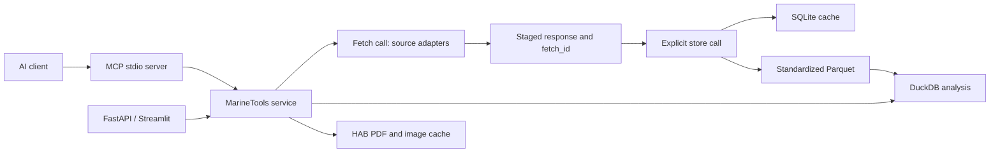

# Backend/MCP Documentation

Marine data pipeline · implementation and verification reference · October 17, 2026

## At a glance: three separate calls

Yes. The normal workflow has **separate fetch, store, and query calls**:

| Step | MCP call | Equivalent REST endpoint | What it does |
| --- | --- | --- | --- |
| 1. Fetch | `fetch_data` | `POST /tools/fetch_data` | Contacts the source and returns a `fetch_id`. The response is staged, not published as saved data. |
| 2. Store | `cache_store` | `POST /tools/cache_store` | Takes that `fetch_id` and saves the response locally. By default it also standardizes the data for analysis. No source request. |
| 3. Query | `pipeline_query` | `POST /tools/pipeline_query` | Reads the saved data. No source request and no automatic download on a cache miss. |

```python
fetched = marine.fetch_data("bantry_wave_buoy")
marine.cache_store(fetched["fetch_id"])
result = marine.pipeline_query("bantry_wave_buoy")
```

Fetch a selection once, store it once, then query it as many times as needed. To update it, explicitly fetch again and store the new receipt. Fetching alone does not change the data returned by queries.

For HAB bulletins, the equivalent sequence is **`fetch_hab_bulletin` → `cache_hab_bulletin` → `get_hab_page`**. The last call reads saved imagery only.

The older named batch workflows (`pipeline_ingest`, `ingest_ocean_colour`, and HAB backfills) deliberately combine phases for compatibility. They are optional workflows, separate from the three individual calls above.

## 1. Purpose and architecture

The recommended workflow is **fetch from the source → cache the fetched response → query saved data**. These are separate operations. Fetching stages a transport receipt but does not publish to raw snapshot tables or analytical datasets. Cache operations never contact upstream services. Reads never fetch missing data. MCP, REST, Python, and Streamlit share these methods.



There are distinct fetch, cache, and read tools. HAB reads are cache-only: a missing or corrupt bulletin returns an error instead of downloading or repairing itself. Named compatibility batch workflows remain explicit orchestration for callers who deliberately request both fetching and caching.

## 2. Start and connect

### Requirements

Python 3.11 or newer and the packages pinned in `requirements.txt`. A project environment is already installed on this machine.

From the project root, a new installation uses:

```powershell
python -m venv .venv
.\.venv\Scripts\python.exe -m pip install -r requirements.txt
```

### MCP client configuration

Use `mcp-config.example.json` in an MCP client that accepts `mcpServers` configuration. That example contains this machine's actual paths. A portable template is:

```json
{
  "mcpServers": {
    "marine-data": {
      "command": "C:/absolute/path/to/project/.venv/Scripts/python.exe",
      "args": ["C:/absolute/path/to/project/mcp_entry.py"],
      "env": {"HAB_API_URL": "http://127.0.0.1:8000"}
    }
  }
}
```

Replace the paths with the project location. The configuration is supplied as an example; it has not been installed into your client settings. The server name is `marine-data`. Its transport is **stdio**: the MCP client launches it as a child process, with protocol messages on stdin/stdout and diagnostics on stderr. It is not an MCP-over-HTTP server.

The absolute entry point resolves the database, source registry, and default ingestion plan against the project location, independently of the MCP client's working directory. Both the entry point and command-line launch share a server lifecycle that resumes durable HAB jobs and closes workers at shutdown.

Manual launch from the project root:

```powershell
.\run.ps1 mcp
```

This waits for protocol messages, rather than presenting an interactive prompt. Do not write application logging to stdout.

### REST and dashboard

The MCP server can query local data without FastAPI running. To retrieve the PNG URLs returned by HAB tools, run the HTTP service against the same cache/database:

```powershell
.\run.ps1 serve --port 8000
# Separate terminal:
.\run.ps1 dashboard
```

The REST base is `http://127.0.0.1:8000`. Interactive route documentation is `/docs`; the OpenAPI document is `/openapi.json`. Set `HAB_API_URL` for MCP and Streamlit if using another port. A PNG reference to the local server is usable by clients that can reach that machine; a remote client cannot automatically reach your localhost.

## 3. Recommended calling workflow

1. `list_sources({})` discovers registered datasets.
2. `pipeline_status({})` checks which selections are standardized and whether they are fresh.
3. `fetch_data(...)` always contacts the source and returns a `fetch_id`, without updating the dataset cache.
4. `cache_store(fetch_id)` saves that response offline and publishes standardized Parquet by default.
5. `pipeline_query(...)` reads records; `analyze_exposure(...)` or `analyze_relationships(...)` performs shared analysis.
6. Retain provenance, units, coverage, truncation, and source limitations in downstream results.

For HAB imagery, call `fetch_hab_bulletin`, then `cache_hab_bulletin` with the returned receipt. Use `get_hab_bulletin_pages` or `get_hab_page` to read the saved results. A cache miss never downloads. Streamlit has separate Fetch, Save, and Load controls.

The generated **`mcp-tools.json`** beside this document contains the actual SDK tool schemas, including input defaults, required fields, constraints, and output schemas. It is an MCP `tools/list` snapshot. The REST `/tools` catalog is a broader function-calling catalog and includes low-level cache functions not exposed as MCP tools.

## 4. MCP tool reference

There are **18 MCP tools**. The following JSON objects are tool arguments. Use the named tool through your MCP client; these are not REST paths.

### Separate fetch and cache operations

| Tool | Arguments | Guarantee |
| --- | --- | --- |
| `fetch_data` | Required `source`; optional `columns`, `constraints`, `slices`, `query`, `cds_request`, `latitude`, `longitude` | Always fetch live; return a receipt ID, source, timestamp, row count, columns, and `cached=false`; no dataset publication |
| `cache_store` | Required `fetch_id`; `publish=true` | Save the fetched response to SQLite and, by default, Parquet; offline |
| `pipeline_publish` | Required `key` | Publish an existing raw snapshot to Parquet offline |
| `fetch_hab_bulletin` | `year=2026`, `week=2` | Fetch/validate a fresh PDF into staging; no rendering or cache publication |
| `cache_hab_bulletin` | Required `fetch_id` | Render and publish an already fetched PDF offline |

Example sequence using named MCP tools:

```json
{"source": "bantry_wave_buoy"}
```

Pass that to `fetch_data`, then pass its returned receipt ID to `cache_store`:

```json
{"fetch_id": "<fetch-id-from-fetch_data>"}
```

Then call `pipeline_query`:

```json
{"source": "bantry_wave_buoy", "limit": 10}
```

Receipts and original downloads are staged under `data/fetches/<fetch_id>/`. Staging is transport storage: queries cannot see a response until it is explicitly cached. Receipts persist across CLI processes, are hash-checked, and remain available for retries/provenance. There is no staging garbage collector; do not delete folders referenced by cached raw-file metadata. Missing, corrupt, or wrong-type receipts produce errors without fetching replacements. Re-caching is idempotent, and an older receipt cannot replace a newer raw snapshot. Cache freshness starts at fetch time.

For raw-cache-only storage use `cache_store(fetch_id, publish=false)`, then `pipeline_publish(key)` when ready. If normalization fails after raw storage, fix the mapping and retry local publication with the key. Repeating `fetch_data` always performs a fresh request, including CDS; it does not reuse the application's raw-download cache.

### Configuration and discovery

| Tool | Arguments and defaults | Result / side effect |
| --- | --- | --- |
| `list_sources` | `{}` | Registry keyed by source name; no upstream fetch |
| `pipeline_status` | `{}` | Local datasets, selected Parquet paths, row counts, freshness, and common schema |
| `register_source` | Required `name`, `url`; optional `adapter="erddap"`, `dataset_type=null`, `location=null`, `ttl_seconds=86400`, `default_query=null`, `response_format="json"` | Writes a new entry in `sources.json`; existing names cannot be replaced silently |

Registration supports `erddap` and `eurosea`. EuroSea `dataset_type` is `sst`, `clim`, `mhw`, or `cs`, with a location token such as `51.675N-9.625W`. ERDDAP accepts JSON or CSV transport. For a URL without a data selection, supply `default_query`. The dedicated CDS source is already configured; generic registration is not a CDS setup tool.

```json
{
  "name": "another_sst",
  "url": "https://eurosea.marine.ie/his",
  "adapter": "eurosea",
  "dataset_type": "sst",
  "location": "51.743N-10.212W"
}
```

### Ingestion

**`pipeline_ingest(sources=null, force=false, selections=null)`**

This is an **explicit compatibility batch workflow** combining fetch, cache, and publication. Use `fetch_data` then `cache_store` to control the phases separately. Omitting `sources` uses `pipeline.json` beside the registry. Fresh saved selections are reused; `force=true` refreshes. `selections` maps source names to request arguments. No read tool invokes this workflow automatically.

```json
{"sources": ["bantry_wave_buoy"], "force": false}
```

Result shape:

```json
{
  "status": "ok",
  "datasets": [{"source": "bantry_wave_buoy", "key": "<snapshot-key>", "row_count": 134416, "reused": true}],
  "errors": []
}
```

Partial failure returns `status="partial_failure"` with per-source `errors`, while preserving successful datasets. It is a valid tool result, so checking the MCP error flag alone is insufficient.

Tabledap selections support projected `columns` and additional AND `constraints` (`field`, `op`, `value`). Operators: `=`, `!=`, `>`, `>=`, `<`, `<=`, `=~`. The registered Bantry filters remain active when structured conditions are added. Grid `slices` use coordinate values in dimension order: **time, release_location, latitude, longitude**.

```json
{
  "sources": ["bantry_particles_csv"],
  "selections": {
    "bantry_particles_csv": {
      "slices": [
        {"start": "last", "stop": "last"},
        {"start": 0, "stop": 5},
        {"start": 51.5, "stop": 51.8, "stride": 20},
        {"start": -10.0, "stop": -9.4, "stride": 20}
      ]
    }
  }
}
```

A raw `query` replaces the full selection, including default filters, and cannot be combined with structured options. EuroSea downloads the complete file for its registered point; filter it locally after ingestion.

**`ingest_ocean_colour(year=2026, month=3, day=31, latitude=51.675, longitude=-9.625, force=false)`**

Requests daily satellite chlorophyll-a through CDS, retains the original global download, and standardizes the nearest grid cell within the adapter's 0.05-degree tolerance on each axis. Uses the same ingestion result shape. One date is requested per call; dates from September 1997 through today can be submitted, subject to published availability. A successful fetch may still yield a null concentration because the cell is masked. No neighbouring-cell substitution is applied.

```json
{"year": 2026, "month": 3, "day": 31, "latitude": 51.675, "longitude": -9.625}
```

CDS requires personal credentials and acceptance of the dataset licences. Configure `.cdsapirc` outside the repository or the `CDSAPI_URL` and `CDSAPI_KEY` environment variables before launching the MCP client/server. Do not put credentials into tool arguments or source configuration. A CDS request can queue and take longer than a local query; configure the client timeout accordingly.

### Offline data access

**`pipeline_query(source, start=null, end=null, filters=null, limit=100, offset=0, allow_stale=false)`**

Reads the most recently published selection for that source. Returns `rows`, `matched_rows`, pagination values, provenance, and `stale`. `limit` is 1–10,000; `offset` is nonnegative. Expired data is rejected unless explicitly permitted. Changing the latest selection does not merge it with previous selections.

```json
{
  "source": "bantry_wave_buoy",
  "filters": [{"field": "variable", "op": "=", "value": "significant_wave_height"}],
  "start": "2024-01-01T00:00:00Z",
  "end": "2024-09-24T23:59:59Z",
  "limit": 100,
  "offset": 0
}
```

Filters are ANDed. Local operators: `=`, `!=`, `>`, `>=`, `<`, `<=`, `in` (nonempty list), `contains` (literal case-insensitive substring), and `is_null`. Dates are inclusive UTC timestamps. A date-only `end` means the beginning of that date, not its final second. Use full timestamps for an entire final day.

### Thermal exposure analysis

**`analyze_exposure`** accepts:

| Argument | Default | Meaning |
| --- | --- | --- |
| `window_days` | `7` | 1–366 days, including sample date |
| `radius_km` | `20` | Nearest environmental point must fall within this radius, greater than 0 and at most 1,000 km |
| `min_coverage` | `0.7` | Required valid daily fraction, 0–1; at least one valid day is always required |
| `start`, `end` | `null` | Inclusive observation timestamp bounds |
| `limit` | `1000` | 1–10,000 output observations |
| `allow_stale` | `false` | Explicitly permit expired input selections |
| `phyto_source` | `bantry_phyto` | Species observations |
| `sst_source` | `eurosea_sst` | Daily SST |
| `clim_source` | `eurosea_clim` | Recurring calendar-day climatology |
| `mhw_source` | `eurosea_mhw` | Heatwave event intervals |
| `cs_source` | `eurosea_cs` | Cold-spell event intervals |

The window includes the sample UTC date and preceding `window_days - 1` dates. Daily values are aggregated before attaching exposure to each phytoplankton observation. Distance uses a great-circle calculation. Climatology matches `MM-DD`, including an explicit leap-day key. Event endpoints are inclusive. Duplicate environmental time/coordinate keys are rejected.

Outputs include counts of valid SST and anomaly days, mean SST, mean anomaly, event-day counts, coverage, distance, `match_status`, method settings, provenance, and `truncated`. Out-of-radius rows remain visible; insufficient coverage yields null summaries/event counts. A zero event count is interpreted within the downloaded event catalog and is not an independent completeness guarantee.

```json
{"window_days": 7, "radius_km": 20, "min_coverage": 0.7, "limit": 50}
```

**`analyze_relationships(window_days=7, radius_km=20, min_coverage=0.7, start=null, end=null, allow_stale=false)`**

Uses the default five thermal/phyto sources and reports per-species Pearson correlation between mean anomaly and raw phytoplankton count, with paired-observation counts. At least three usable pairs and nonzero variance are required; otherwise correlation is null. It rejects analyses exceeding 10,000 observations rather than silently correlating a truncated sample. Narrow dates when needed.

These are exploratory associations, with no adjustments for seasonality, repeated samples, spatial dependence, autocorrelation, or multiple comparisons. They are not a predictive model or causal effect estimate. Wave variables, chlorophyll, and bulletin images are not automatically joined into this analysis.

### HAB bulletin tools

| Tool | Arguments | Result |
| --- | --- | --- |
| `get_hab_bulletin_pages` | `year=2026`, `week=2` | Cache-only metadata and URLs for physical pages 12/13; a miss is an error |
| `get_hab_page` | Required `year`, `week`, `page` | Absolute PNG URL, MIME type, source URL, PDF hash, image hash |
| `list_available_hab_bulletins` | `year=null` | Successfully cached bulletins whose files and hashes validate |
| `backfill_hab_bulletins` | `year=2026`, `start_week=2`, `end_week=51` | Durable job identifier and status URL |
| `hab_backfill_status` | Required `job_id` | Progress, per-week errors, cache/download/missing/failure counts, storage, elapsed time |

All week values must be strict integers **2–51 inclusive**; page must be **12 or 13**. Booleans, floats, and numeric strings are rejected in MCP/Python. Backfill also requires `start_week <= end_week`.

```json
{"year": 2026, "week": 7, "page": 12}
```

The fetch phase validates PDFs without rendering. The cache phase renders at 200 DPI without OCR and publishes a consistent generation containing the original and two PNGs. Short/invalid PDFs and hash mismatches are rejected. Missing/corrupt assets are not repaired by reads: explicitly re-cache a receipt or fetch a new PDF. Per-bulletin locks coordinate publication. Legacy batch backfills retain negative caching for unavailable bulletins; explicit fetch calls always contact the source.

Backfill covers at most 50 candidate bulletins for a year. The persistent MCP or API process executes jobs with bounded concurrency and resumes unfinished work at startup. A completed job means every candidate was attempted; examine `missing` and `failed` before declaring the archive complete. A one-shot CLI tool call only enqueues durable work; use the dedicated `hab-backfill` command or leave MCP/API running.

Issue week identifies the bulletin, not forecast validity dates or observed measurements. Forecast validity remains unknown unless explicitly established from an appropriate source.

## 5. Registered sources

| Source | Upstream | Default selection / units |
| --- | --- | --- |
| `bantry_phyto` | Marine Institute `habs_phyto` tabledap | Bantry filter; default plan starts January 2025; count unit unspecified by source |
| `eurosea_sst` | EuroSea `/his` POST | Requested point 51.675N, 9.625W; Celsius |
| `eurosea_clim` | EuroSea `/his` POST | Same point; calendar-day mean and percentiles, Celsius |
| `eurosea_mhw` | EuroSea `/his` POST | Same point; heatwave intervals |
| `eurosea_cs` | EuroSea `/his` POST | Same point; cold-spell intervals |
| `bantry_particles_csv` | `BANTRY_PARTICLES.csv` | Latest available time, six releases, spatial stride 20; hours |
| `bantry_particles` | Original particle link / JSON | Fixed October 17, 2026 selection, full spatial resolution |
| `bantry_wave_buoy` | `IWaveBNetwork.csv` | Bantry Bay station; temperature `degree_C`, wave height `cm`, period `s`, direction `degrees_true` |
| `ocean_colour` | CDS `satellite-ocean-colour` | Explicitly requested daily chlorophyll-a v6.0; `mg m-3` |

The default plan ingests seven feeds: four EuroSea products, phytoplankton, particle CSV, and wave buoy. Original particle JSON and credentialed ocean colour require explicit selection. HAB imagery is a separate cached asset service, not a row-based source in this registry.

The buoy source has four standardized measurement rows per upstream station/timestamp. Its latest timestamp observed during integration was September 24, 2024 at 10:00 UTC, so it does not currently overlap the default 2025-onward phytoplankton selection. Particle stride is subsampling, not a spatial average. EuroSea coordinates represent the requested point, not an independently verified satellite-cell center.

## 6. Standardized data and storage

All analytical Parquet files use one nullable schema:

| Fields | Type / meaning |
| --- | --- |
| `source`, `snapshot_key` | String provenance identifiers |
| `time`, `time_end` | UTC timestamps; date-only records become midnight UTC |
| `latitude`, `longitude`, `release_location` | Numeric coordinates/dimension |
| `variable`, `value`, `unit` | Measurement name, nullable numeric value, explicit unit |
| `sample_id`, `species`, `location_name` | Observation identity / classification |
| `calendar_day` | Recurring `MM-DD` climatology key |
| `climatology_c`, `p10_c`, `p90_c` | Numeric Celsius climatology fields |
| `event_id`, `duration_days`, `category` | Event metadata |
| `raw_json` | Original row for traceability; omitted by `pipeline_query` |

Missing, nonfinite, and metadata fill values normalize to null. Unknown units remain unknown. Unit overrides label data and do not perform conversion. Counts, satellite chlorophyll, model particle hours, and bulletin images retain their different meanings.

| Location | Purpose |
| --- | --- |
| `sources.json` | Endpoint registry, adapter settings, TTL, normalization |
| `pipeline.json` | Default sources and upstream selections |
| `data/marine.sqlite` | Raw snapshots, metadata, HAB assets index and job progress |
| `data/raw/` | Original CSV/CDS artifacts and provenance |
| `data/parquet/<source>/` | Standardized analytical snapshots |
| `data/analytics.duckdb` | Manifest selecting the current file per source |
| `data/hab/<year>/week_<NN>/<generation>/` | Original bulletin and separate page images |

SQLite is the ingestion cache; Parquet and DuckDB are the analytical layer. Source-name queries select the current manifest file. Historical selections remain available through stored snapshot keys and low-level Python/REST tools; they are not automatically concatenated. Do not glob every historical Parquet version without handling duplicates.

TTL refers to time since fetch, not observation age. A freshly downloaded historical buoy file is fresh cache even though its observations are old. Refresh and ingestion failures preserve previously published data. Normalization uses Arrow batches for multi-measurement archives.

## 7. REST routes and authentication

REST is an additional interface and image transport, separate from MCP stdio.

| Method | Path | Purpose |
| --- | --- | --- |
| GET | `/health` | Status |
| GET | `/sources` | Data registry |
| GET | `/tools` | Broader function catalog |
| GET | `/cache` | Raw snapshot inventory |
| POST | `/tools/{name}` | Invoke a catalog function with a JSON object |
| GET | `/api/hab` | HAB service discovery and bounds |
| GET | `/api/hab/available` | Cached bulletins; optional `year` |
| GET | `/api/hab/{year}/{week}` | Read cached metadata only; 404 on a miss |
| GET | `/api/hab/{year}/{week}/page/{page}` | Cached `image/png` |
| POST | `/api/hab/{year}/{week}/refresh` | Protected fresh fetch only; cache the returned receipt explicitly |
| POST | `/api/hab/backfill` | Protected background job submission, HTTP 202 |
| GET | `/api/hab/backfill/{job_id}` | Job progress |

Send `Content-Type: application/json` for JSON POST calls. Invalid HAB bounds return HTTP 422. Missing bulletins return 404 with negative-cache behavior; transient failures have bounded retry handling. Tool validation failures over MCP produce error results rather than HTTP status codes. Ingestion can also return per-source errors inside a successful protocol response.

HTTP HAB refresh/backfill require `HAB_ADMIN_TOKEN` and `Authorization: Bearer <token>`; administrative calls share a ten-per-minute limit per API process. Local Python, CLI, and stdio MCP are trusted interfaces and use the backend directly. The local API is not hardened for unauthenticated public hosting.

## 8. Environment and operations

| Setting | Default / purpose |
| --- | --- |
| `HAB_API_URL` | `http://127.0.0.1:8000`; PNG references and dashboard client |
| `HAB_CACHE_DIR` | `hab/` beside the selected SQLite DB |
| `HAB_ADMIN_TOKEN` | Unset; HTTP refresh/backfill disabled until configured |
| `HAB_CONCURRENCY` | `2`; accepted 1–8 |
| `HAB_REQUEST_INTERVAL` | `0.5` seconds between upstream attempts per service |
| `HAB_TIMEOUT` | `30` seconds |
| `HAB_RETRIES` | `2` additional attempts; accepted 0–5 |
| `HAB_NEGATIVE_TTL` | `21600` seconds |
| `HAB_URL_TEMPLATE` | Marine Institute year/week PDF template |
| `HAB_YEAR_TEMPLATES` | JSON year-to-template overrides; default `{}` |
| `CDSAPI_URL`, `CDSAPI_KEY` | Credentialed CDS access; alternatively personal `.cdsapirc` |

Run one analytical ingestion process at a time. DuckDB uses process-level file locks, so overlapping writers from MCP, API, and Streamlit can conflict. HAB uses separate filesystem locking and persistent jobs. Run one local API worker for this deployment. There is no distributed scheduler, automatic historical backfill, or automatic calendar schedule.

Source configuration edits should be serialized. Changed normalization settings may require a fresh ingest (`force=true`) because cache reuse is based on the selection and fetch time. Large upstream responses are parsed in memory with limits; narrow dates/bounds or increase grid stride. EuroSea downloads may require generating a new requested point on its map first.

For new generic ERDDAP variables, configure `normalization.value_field`, `variable`, optional verified `unit`, and `fields` aliases in the registry. Multi-measurement sources use `normalization.measurements`. Add source names to the default plan deliberately. Other service protocols require an adapter.

## 9. Verification results

Verified on October 17, 2026:

| Check | Result |
| --- | --- |
| Full pytest suite | **106 passed, 0 failed, 0 errors, 0 skipped** |
| Installed dependency consistency | `pip check`: no broken requirements |
| Python compilation | Passed for service modules, dashboard, and entry point |
| All 18 MCP tool dispatch contracts | Passed using mocked shared backend calls |
| Actual MCP subprocess | Initialization, tool listing, and calls passed |
| Launch from another working folder | Passed with the absolute entry point |
| Cached analytical data | Queried all 8 currently ingested datasets |
| Exposure / relationships | MCP calls succeeded; relationship result covered 187 species with usable pairs |
| HAB week 07 image routes | Both returned HTTP 200 and `image/png` |
| REST discovery/docs | `/health`, `/api/hab`, `/docs`, `/openapi.json` returned HTTP 200 |
| Streamlit views | Environmental data, HAB bulletins, and Ocean colour loaded with no application exceptions |

Test artifacts beside this document:

- `test-results.xml`: full JUnit test report.
- `verification.json`: real MCP subprocess and current cached-data smoke results.
- `separation-verification.json`: a live buoy fetch in an isolated database, followed by cache/publication and reads with fetching disabled; existing project selections unchanged.
- `mcp-tools.json`: generated SDK tool catalog and schemas.

Reproduce from the project root:

```powershell
.\.venv\Scripts\python.exe -m pytest -q --basetemp=data/pytest-mcp-documentation-final --junitxml=backend/test-results.xml
.\.venv\Scripts\python.exe -m pip check
.\.venv\Scripts\python.exe -m compileall -q marine_tools app.py mcp_entry.py
.\.venv\Scripts\python.exe -m examples.mcp_smoke
.\.venv\Scripts\python.exe -m examples.separation_check
```

The smoke check uses existing cached selections and explicitly permits stale reads for diagnostics, reporting freshness per source. On this run all eight selections were fresh. It does not re-download all upstream archives, submit a CDS job, or backfill all candidate weeks. Upstream paths have mocked error coverage; historical live ingestion reports are under `data/`. Passing tests establishes these checked behaviors, not universal availability of external services.

## 10. Problems found, fixes, and remaining limits

**Fixed:** default ingestion previously looked for `pipeline.json` in the MCP client's working folder. It now resolves beside the selected registry, avoiding unexpected source selection when a client launches elsewhere. A regression test verifies this behavior.

**Fixed:** the standalone absolute MCP entry point previously did not start the durable HAB job scheduler. Shared MCP startup/shutdown now resumes jobs and closes workers for every entry point. Lifecycle and cleanup on failure are covered by a regression test.

**Changed by request:** fetching and caching are independent tools. HAB GET/read calls no longer download or regenerate assets. `/tools/cache_fetch` was removed because its name hid a combined operation; the Python helper remains only for compatibility batch orchestration. `pipeline_ingest`, `ingest_ocean_colour`, and background backfills are explicitly named batch workflows. Existing GET clients must fetch and save first.

**Fixed during separation:** receipt-integrity errors were masked by a generic error, and temporary Windows/OneDrive directory locks could interrupt atomic PDF publication. Integrity errors are preserved; local publication uses bounded retries without downloading again. Tests cover these failures and prove cache/read operations work with all upstream adapters disabled.

**Data limitation:** the currently cached March 31, 2026 ocean-colour cell has a null chlorophyll value. Ingestion succeeded, but there is no usable concentration for that cell/date; the backend preserves the mask rather than inventing a measurement. Two particle sample rows also had null values. Downstream analysis must check nonmissing coverage.

**Data limitation:** the buoy archive ends in September 2024 while the default phytoplankton selection starts in 2025. A joint buoy/phyto study needs overlapping historical selections. The thermal-exposure tool does not currently integrate waves or chlorophyll automatically.

**Operational limitation:** simultaneous DuckDB writers across processes are unsupported. HAB PNG URLs require the REST service and shared cache. CDS access requires credentials/licences and upstream availability. These are documented constraints, not test failures.

**Scientific limitation:** proximity and correlation do not establish ecological representativeness or causation. Climatology baseline details are source-defined and not supplied by the EuroSea CSV. Do not reinterpret unknown units, forecast dates, or missing values.

No unresolved automated test failures remained after the fixes.

## 11. Troubleshooting

| Symptom | Action |
| --- | --- |
| MCP server waits silently when launched manually | Expected for stdio; connect through an MCP client |
| Tool missing in client | Restart/reconnect and inspect `tools/list`; compare `mcp-tools.json` |
| `Ingest <source> first` | Call `pipeline_ingest` for that source and inspect its `errors` |
| Snapshot expired | Refresh explicitly, or use `allow_stale=true` only when acceptable |
| DuckDB file locked | Finish the other analytical process and retry; serialize ingestion |
| HAB URL cannot load | Start REST against the same DB/cache; check `HAB_API_URL` and client network reachability |
| HAB 404 | Verify year/week and source convention; respect negative-cache retry timing |
| HAB 422 / MCP validation error | Use integer week 2–51 and page 12/13 |
| HAB administrative HTTP 503 | Set `HAB_ADMIN_TOKEN` before starting the API |
| HAB administrative HTTP 401 / 429 | Supply the correct bearer token / wait for rate limit reset |
| Backfill says completed but some weeks absent | Inspect `missing`, `failed`, and per-week errors |
| CDS credential/download error | Configure personal credentials and accept licences; verify publication date |
| Successful ingestion with null `value` | Missing/masked observation; inspect coverage and choose another date only deliberately |

## 12. Code map

| Module | Responsibility |
| --- | --- |
| `mcp_entry.py` | Absolute-path MCP launch |
| `marine_tools/mcp_server.py` | MCP schemas, dispatch wrappers, lifecycle |
| `marine_tools/system.py` | Shared facade, source registry, raw cache |
| `marine_tools/pipeline.py` | Normalization, Parquet publication, DuckDB analysis |
| `marine_tools/api.py` | FastAPI, function catalog, HAB routes and HTTP administrative protection |
| `marine_tools/eurosea.py` | POST form download and CSV validation |
| `marine_tools/erddap_csv.py` | CSV transport with names/units handling |
| `marine_tools/ocean_colour.py` | CDS download, raw caching, nearest-cell extraction |
| `marine_tools/hab.py`, `hab_pdf.py`, `hab_jobs.py` | Bulletin cache, page rendering, durable jobs |
| `marine_tools/hab_client.py` | Reusable HTTP client for presentation |
| `app.py` | Streamlit interface using shared services |
| `tests/` | Unit, contract, integration, validation, and transport tests |
